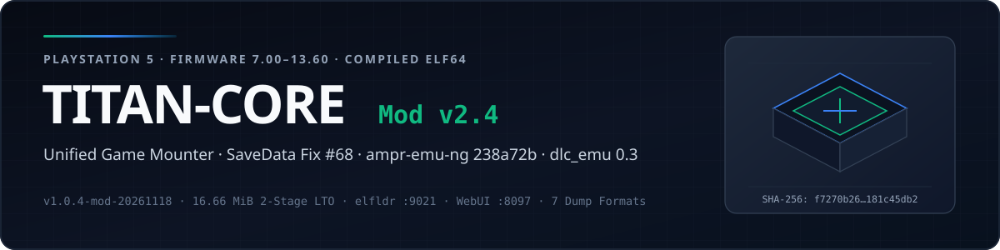
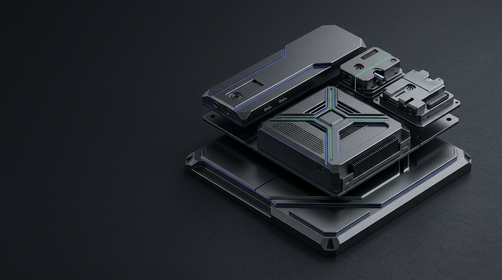

<div align="center">

<a href="https://github.com/hsdsacxa1/ps5all-IN/releases/tag/v1.0.4-mod-20261118">
  
</a>

<br />

[](https://github.com/hsdsacxa1/ps5all-IN/releases/tag/v1.0.4-mod-20261118)
[](https://github.com/hsdsacxa1/ps5all-IN/releases/tag/v1.0.4-mod-20261118)
[](https://github.com/hsdsacxa1/ps5all-IN/releases/download/v1.0.4-mod-20261118/TITAN-CORE-v1.0-mod-20261118-v2.4.elf)
[](https://hsdsacxa1.github.io/ps5all-IN/)

<h3>Ready-to-Deploy Compiled PS5 ELF64 Unified Game Mounter, Emulators &amp; Crash Telemetry</h3>

<p>
  <a href="https://github.com/hsdsacxa1/ps5all-IN/releases/download/v1.0.4-mod-20261118/TITAN-CORE-v1.0-mod-20261118-v2.4.elf"><strong>Download Compiled ELF64 (16.66 MiB)</strong></a>
  &nbsp;·&nbsp;
  <a href="https://github.com/hsdsacxa1/ps5all-IN/releases"><strong>Browse Releases by Version</strong></a>
  &nbsp;·&nbsp;
  <a href="#quick-deploy-to-ps5-fw-7001360"><strong>Quick Deploy</strong></a>
  &nbsp;·&nbsp;
  <a href="./docs/index.html"><strong>Interactive Landing</strong></a>
</p>



</div>

---

## Releases Separated by Version

Each GitHub Release contains **strictly its own version artifacts and dedicated checksum manifest** — zero mixed piles.

| Version | GitHub Release | Primary Artifact | Package Scope | Key Milestone |
| :--- | :--- | :--- | :---: | :--- |
| **Mod v2.4 (Latest)** | [`v1.0.4-mod-20261118`](https://github.com/hsdsacxa1/ps5all-IN/releases/tag/v1.0.4-mod-20261118) | [`TITAN-CORE-v1.0-mod-20261118-v2.4.elf`](https://github.com/hsdsacxa1/ps5all-IN/releases/download/v1.0.4-mod-20261118/TITAN-CORE-v1.0-mod-20261118-v2.4.elf) (`16.66 MiB`) | 6 isolated files | Скомпилированный PS5 ELF64 (17,467,672 B / 16.66 MiB, clang-19.1.7 + Rust 1.99.0 + SDK v0.43) |
| Mod v2.3 | [`v1.0.3-mod-20261118`](https://github.com/hsdsacxa1/ps5all-IN/releases/tag/v1.0.3-mod-20261118) | [`TITAN-CORE-v1.0.3-mod-20261118-src.tar.gz`](https://github.com/hsdsacxa1/ps5all-IN/releases/download/v1.0.3-mod-20261118/TITAN-CORE-v1.0.3-mod-20261118-src.tar.gz) (`1.12 MiB`) | 5 isolated files | Google Drive Crash Telemetry (OAuth 2.0 + автономный Webhook для оффлайн-консолей DNS 127.0.0.2) |
| Mod v2.2 | [`v1.0.2-mod-20261118`](https://github.com/hsdsacxa1/ps5all-IN/releases/tag/v1.0.2-mod-20261118) | [`TITAN-CORE-v1.0.2-mod-20261118-src.tar.gz`](https://github.com/hsdsacxa1/ps5all-IN/releases/download/v1.0.2-mod-20261118/TITAN-CORE-v1.0.2-mod-20261118-src.tar.gz) (`1.12 MiB`) | 5 isolated files | Debug API (:8097): /api/debug/memory (KERN_PROC_VMMAP), /api/debug/mounts, /api/debug/error-dump, /api/debug/bundle |

---

## Quick Deploy to PS5 (FW 7.00–13.60)

1. Start `elfldr` on your PS5 (TCP port `9021`) via Y2JB or WebKit.
2. Send the compiled **Mod v2.4** payload directly to your console:

```bash
nc -w 10 <PS5_IP> 9021 < TITAN-CORE-v1.0-mod-20261118-v2.4.elf
```

3. Open the built-in TITAN-CORE WebUI & Diagnostics panel:

```text
http://<PS5_IP>:8097/
```

---

## Core Capabilities (Mod v2.4)

<table>
  <tr>
    <td width="50%" valign="top">
      <h3>SaveData Protection (#68 / #64 / #76)</h3>
      <code>keep_fakelib()</code> blocks <code>libSceSaveData.native.sprx</code> alongside <code>libkernel.sprx</code> so game dump fakelibs never shadow the system save module. Bumps <code>STAMP_V = 3</code> to auto-refresh caches.
    </td>
    <td width="50%" valign="top">
      <h3>Bundled ampr-emu-ng beta 238a72b</h3>
      Verified <code>libSceAmpr.sprx</code> (<code>256 MiB</code> PRX pool + <code>ScratchBuffer::reset</code> Drop recursion fix) with <strong>mandatory AMPR injection</strong> for every <code>.pkg</code> title (<code>#73</code>).
    </td>
  </tr>
  <tr>
    <td width="50%" valign="top">
      <h3>Bundled drakmor dlc_emu 0.3 &amp; PlayGo 0.6</h3>
      Embeds <code>libSceAppContent</code>, <code>libSceGameUpdate</code>, and <code>libSceNpEntitlementAccess</code> (<code>add_emulators</code> + <code>dlc_emu_exclude</code>) plus per-title <code>libScePlayGo.sprx</code> toggles.
    </td>
    <td width="50%" valign="top">
      <h3>Safe USB Unmount &amp; 3-Region Y2JB Guard</h3>
      <code>POST /api/usb/unmount</code> safely ejects <code>/mnt/usb0..7</code> preserving caches; <code>auto_remove_missing</code> hides unplugged drives after 5m while protecting <code>PPSA01650/1/2</code>.
    </td>
  </tr>
</table>

---

## All 7 Supported PS5 Dump Formats

| Format | Extensions / Markers | Backend |
| :--- | :--- | :--- |
| **Plain Folder** | `<TITLE_ID>/eboot.bin` | Native / ShadowMountPlus `1.7beta12` |
| **LZ4 Folder** | `ampr_assets.index` | `ampr-emu-ng beta 238a72b` (8-byte index `#64`) |
| **Zstandard Folder** | `ampr_zstd.index` | `ampr-emu-ng beta 238a72b` (8-byte index `#64`) |
| **Debug / Sparse PKG** | `*.pkg` (+ 16 Protected CNT fallbacks) | `titan-core-pkg` + mandatory AMPR |
| **PFS Images** | `*.ffpkg`, `*.ffpfsc` | ShadowMountPlus bridge |
| **Compressed Archives** | `*.zst`, `*.lz4` | Direct AMPR mount |
| **Disk Images** | `*.exfat`, `*.img` | Loopback / external mount |

---

<details>
<summary><strong>Mod v2.4 SHA-256 Checksums &amp; Verification</strong></summary>

| Artifact | Size | SHA-256 |
| :--- | ---: | :--- |
| `TITAN-CORE-v1.0-mod-20261118-v2.4.elf` | `16.66 MiB` | `f7270b26ebfa10c36e37c2aa7910e549bb19d981c34d219ba00621a181c45db2` |
| `TITAN-CORE-v1.0.4-mod-20261118-src.tar.gz` | `1.49 MiB` | `01943a0f06eedd2726bd5556c41afccea2eebcd77fb2cb27299b2cc0661326ba` |
| `TITAN-CORE-v1.0-mod-20261118-v2.4.patch` | `109.8 KiB` | `7874564cb8af54065600c67929412ab69023add05996c7c7f9b8c306c4823275` |
| `TITAN-CORE-v1.0-mod-20261118-v2.4.elf.txt` | `2.8 KiB` | `8f82587758107f12103c1d95b08883b07d295887ea48b301e91e21f014a55f7e` |

Verify locally:
```bash
sha256sum -c SHA256SUMS-v2.4.txt
```

</details>

<details>
<summary><strong>Built-in HTTP Diagnostics &amp; Crash Telemetry API (:8097)</strong></summary>

- `GET /api/debug/memory` — `getrusage`, FreeBSD `KERN_PROC_VMMAP` (`sysctl`), `libSceAmpr.sprx` map check, `/data` free space.
- `GET /api/debug/mounts` — `getmntinfo` + `unionfs` `common/lib` collision detector.
- `GET /api/debug/error-dump` — 256-slot `errno` ring buffer + panic hook dumping `/data/titan-core/debug/last-crash-bundle.json`.
- `POST /api/debug/dump-bundle` — Atomic JSON forensics snapshot to `/data/titan-core/debug/titan-debug-latest.json`.
- `POST /api/usb/unmount` — Safe USB drive eject preserving game caches.

</details>

<details>
<summary><strong>Building from Source (clang-19 + Rust 1.99 + ps5-payload-dev/sdk v0.43)</strong></summary>

```bash
tar -xzf TITAN-CORE-v1.0.4-mod-20261118-src.tar.gz
cd TITAN-CORE-v1.0.4-mod-20261118
TITAN_UNIFIED_STACK=1 bash ps5/build.sh
```

Verified: `RUSTFLAGS=-Dwarnings` 0 warnings, `cargo test -p titan-core-pkg` 8/8 passing, 2-stage LTO self-copy ELF64.

</details>

---

## Credits & Upstream Projects

- [`devchmod/TITAN-CORE`](https://github.com/devchmod/TITAN-CORE) — Upstream base (`v1.0.0`)
- [`quer3q/kraken-mount`](https://github.com/quer3q/kraken-mount), [`quer3q/ampr-emu-ng`](https://github.com/quer3q/ampr-emu-ng), [`quer3q/ps5-dump-forge`](https://github.com/quer3q/ps5-dump-forge) — SaveData fix, AMPR `238a72b`, 8-byte index validation
- [`drakmor/ShadowMountPlus`](https://github.com/drakmor/ShadowMountPlus) & `dlc_emu 0.3` — ShadowMountPlus `1.7beta12` & DLC emulator PRX
- [`EchoStretch/kstuff-lite`](https://github.com/EchoStretch/kstuff-lite) — `kstuff-lite v1.11`
- [`grimmtroll2285-dot/TITAN`](https://github.com/grimmtroll2285-dot/TITAN) — PlayGo Stub `0.6`, 3-region Y2JB protection, Schema v1 backports
